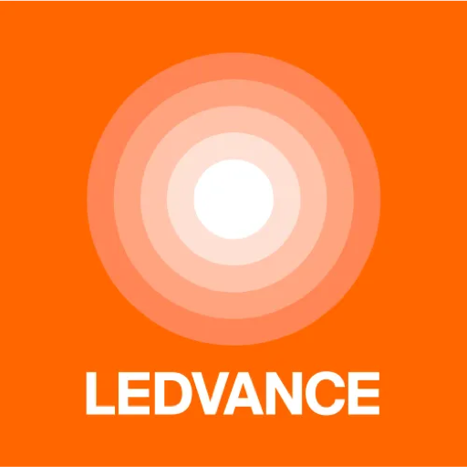

# Ledvance SMART+ WiFi for Raycast

Control LEDVANCE **SMART+ WiFi** lights **locally** from Raycast — no cloud, no vendor app.

Built for the **SMART+ WiFi Planon Plus** ceiling panel (45×45 cm, RGBTW, 3000–6500 K), and
expected to also work with the Smart+ RGBW/RGBTW bulb family that shares the same Tuya schema
(untested per model — feedback welcome).

<p align="center">
  
</p>

## How it works

The panel is a white-labelled Tuya device speaking the **Tuya local protocol v3.3** on
TCP 6668. This extension talks to it directly on your LAN:

- **Control Panel** — see the current state (power, mode, brightness, CCT, colour) and change
  everything from one place: power, brightness, colour temperature, a built-in colour picker,
  and one-keystroke switching between white and colour rendering that remembers both settings.
- **Scenes** — static presets (**Night**, **Read**, **Meeting/Work**) and animated moods
  (**Rainbow**, **Leisure**) that run until you stop them or switch the light off.

Everything is sent as a single, internally consistent state write per action, with the
panel's firmware quirks (mode-dependent brightness carriers, silent commands, unreliable mode
reports, transient errors) handled and pinned by tests.

## Requirements

- A Ledvance SMART+ WiFi light on the **same network** (it must be reachable via TCP 6668)
- The light's **device ID** and **local key** (extract once from the Smart Life / Tuya app —
  e.g. with [tinytuya](https://github.com/jasonacox/tinytuya)'s scan tool) and its **local IP**
- Optional: fixed IP / DHCP reservation for the light, so the address stays stable

## Setup

1. Install dependencies and start a dev session or build:
   ```bash
   npm install
   npm run dev        # live development against the panel
   # or
   npm run build      # produce the importable build
   ```
2. Import in Raycast (dev session prompts automatically).
3. Fill in **Device ID**, **IP address** and **Local key** in the extension's preferences —
   Raycast asks for them on first use. Protocol version can stay `3.3`.

No initialization scripts, no accounts, no cloud. The key stays on your machine.

## Commands

| Command | What it does |
|---|---|
| **Control Panel** | Live status + all controls (power ⌃Space, brightness ⌃+/⌃−, temperature ⌃L/⌃H, mode switch ⌃C/⌃W, colour picker ⌥C) |
| **Scenes** | Static presets and unlimited-run animated scenes with immediate stop |

## Notes & limits

- Local control only: scenes are generated client-side (the vendor app's built-in scenes are
  cloud-delivered and cannot be triggered locally).
- White and colour cannot render at the same time — the panel has one light engine with two
  render modes; the extension keeps both modes' last settings and switches between them.
- If the light is controlled from the phone app in between, use the Control Panel's refresh
  to re-sync before the next change.

## Development

See [AGENTS.md](AGENTS.md) for the architecture contract, the hardware-verified protocol facts,
and the testing rules. In short: `npm run dev` to iterate, `npm run test` (29 tests pin the DP
contract), `npm run typecheck` / `npm run lint` before committing.

## Credits

Built on [tuyapi](https://github.com/codetheweb/tuyapi). Firmware behaviour documented from
packet-level debugging against the real panel.
